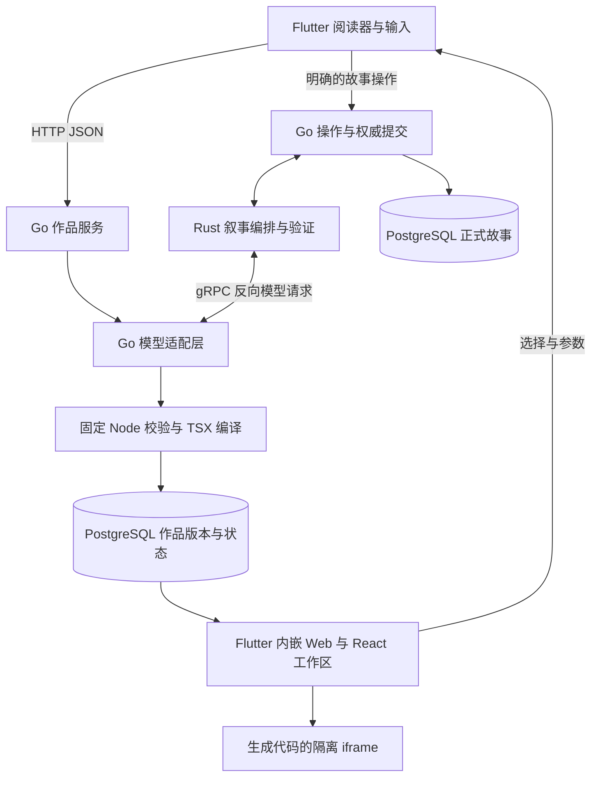

# ElseLife 正式工程与智能 UI 方案对照评估

核查日期：2026-10-16，Asia/Singapore。方案为[《聊天驱动的智能体富交互界面》](<C:/Users/16039/Desktop/聊天驱动的智能体富交互界面_完整方案与技术取舍_2026-10-09 (1).md>)；代码目标为 `C:/workspace/elselife`，不是当前聊天目录中的 Node/React Demo。

**结论：智能 UI 应按当前剧情和用户任务出现，纯文字也是完整、正确的呈现结果。正式工程已有丰富的 Web 交互与故事权威边界，但“不需要界面”的决定尚未可靠贯通到显示层。首先确保该出现才出现、无关时能撤下，再补输入稳定性、结构化对象引用和数据表语义。保留 Flutter、Go、Rust、PostgreSQL 主干；目前没有足够理由整体迁移 A2UI/GenUI。**

本次评估只新增报告与隔离验证文件，没有修改正式工程、调用真实模型或读取玩家故事。正式工程另有开发进行，因此判断针对本次读取时的源码；文档中的历史验证成绩不作为本次新测成绩。方案第 23 章的开发委托仅作为待对照内容，没有据此执行改造或发布。

“已实现”表示找到明确代码路径；“部分”表示只覆盖目标的一部分；“缺口”表示在检查的正式路径、依赖、测试和记录中未找到完整实现；“选型差异”不自动等于错误。源码测试覆盖与本轮运行结果分别说明。

**用户确认的呈现原则（2026-10-16 补充）**

智能 UI 只在对当前场景、剧情或用户意图有明确帮助时出现。先判断是否有呈现价值，再选择合适形式；不把每回合生成作品、出现更多组件或展示全部已有资料当成目标。判断依据应包含近期公开剧情、当前待理解或待执行的事项、用户请求与已有界面的相关性。评估可以在剧情变化后发生，但评估不代表必须展示，也不要求每次普通输入先增加一轮模型分类。

| 场景 | 呈现原则 |
|---|---|
| 普通对话、情绪推进、描写、无待解决事项 | 只显示正文；不增加“本次无需 UI”的占位卡或生成面板。 |
| 多个选项需要比较，文字不易判断差异 | 按实际需要提供精简比较表或卡片；两个简单选项也可以继续用文字。 |
| 空间关系影响路线选择 | 显示与当前决策有关的地图或路线；故事里出现地名本身不是触发条件。 |
| 人物关系或事件先后难以理解 | 选择关系图或时间线；不因为出现人名、日期就自动生成。 |
| 参数调整、交易或行动准备确需操作 | 提供对应的操作界面，明确预览与正式提交的区别。 |
| 现有界面仍有帮助 | 保留或局部更新，维持用户选择、输入与阅读位置。 |
| 场景变化后旧界面已无关 | 撤下当前呈现，保留事实、历史和可恢复状态；资料存在不等于必须显示。 |

最小契约应明确区分“不显示”“保留”“更新/新建”，让“不显示”一直传到最终挂载判断。不能通过删除权威游戏资料来隐藏界面。自动评估失败、且用户没有请求界面时，应允许继续安静阅读并记录诊断；用户主动请求的界面失败则应给出可理解的反馈。具体组件由任务选择，不要求用户先选择 UI 类型。

**当前实际链路**



UI 生成直接由 Go 调模型，Rust 参与正式叙事。Node 是固定校验与编译工具，模型生成代码在浏览器沙箱执行。依据：[作品生成](C:/workspace/elselife/backend/internal/experience/artifacts.go:337)、[叙事适配](C:/workspace/elselife/backend/internal/experience/algorithm.go:68)、[正式提交](C:/workspace/elselife/backend/internal/experience/service.go:599)、[前端嵌入](C:/workspace/elselife/frontend/lib/experience/reader_artifact_surface_web.dart:39)。

**按方案目标逐项对照**

| 方案章节与目标 | 状态 | 当前实现与差距 | 调整判断 |
|---|---|---|---|
| §1、§9 保留 Flutter/Go/Rust，Go 掌握正式事实 | 核心已实现；职责有差异 | Flutter 主体、Go writer、Rust 叙事成立；UI 生成和动作语义审核在 Go。[生成入口](C:/workspace/elselife/backend/internal/experience/artifacts.go:337)、[审核入口](C:/workspace/elselife/backend/internal/experience/gameplay_execution.go:168) | 保留；把方案职责图更新到实际实现，不为语言分工而搬运成熟代码。 |
| §2、§5、§6 阅读为主，资料按需出现 | 部分；发现 none 显示语义断点 | 提示允许 none/keep，但准备器丢弃 none 决定并保留权威 game；前端用其中 surfaces/spatial/journeys 判定有界面。[准备器](C:/workspace/elselife/tools/artifact-validator/validate.mjs:21)、[显示判定](C:/workspace/elselife/frontend/lib/experience/reader_artifact_repository.dart:33)。自动失败也可打开工作台。[挂载门槛](C:/workspace/elselife/frontend/lib/experience/reader_tools.dart:836) | 首要修正：明确呈现决定、保留事实但撤下无关 UI；用场景适配与阅读打断评价，而非组件数量。 |
| §4、§11 自然语言与按钮进入同一能力 | 部分；当前入口有明显差异 | 后端能解释自然语言并形成正式操作，但主输入仅命中 `readerRichRequest` 才进入 UI 路由；普通行动直接续写。[门槛](C:/workspace/elselife/frontend/lib/experience/experience_screen.dart:220)、[窄语法](C:/workspace/elselife/frontend/lib/experience/reader_rich_request.dart:18)、[当前行为测试](C:/workspace/elselife/frontend/test/experience/reader_tools_test.dart:653) | 优先补；不要简单恢复“每次输入先额外调一次模型”。明确查询、作品续改和故事模式，语义理解尽量合并已有调用，避免无结果或多余等待。 |
| §4、§8、§17 “这两个”有稳定对象指代 | 部分；传输断点明确 | 资料选择保留经历/分支/版本/objectIds；发送时退化为名称、页码、摘要文字，ID 没进入正式请求。[选择校验](C:/workspace/elselife/frontend/lib/experience/reader_context_projection.dart:71)、[拼接位置](C:/workspace/elselife/frontend/lib/experience/experience_screen.dart:281) | 高优先级：结构化引用独立传递，显示文本仅用于阅读；服务端按当前可见范围解析 ID。 |
| §7、§10 少量组件目录、薄协议 | 自有实现较完整；标准互通缺口 | 已有表格、图表、图示、卡片、时间线、插画、表单、表达式、正式动作及 HTML/React；不是只有简单组件映射。[目录](C:/workspace/elselife/frontend/assets/reader_artifact/rich-interaction.js:3)、[提示定义](C:/workspace/elselife/backend/internal/experience/artifact_prompt.txt) | 先固定目录和数据/动作封套，不继续无边界扩充通用语法；协议迁移只替换呈现描述。 |
| §8 小解释表与本地排序筛选 | 基本实现 | 具有表头、行头、筛选、数量、横向滚动及本地排序。[渲染](C:/workspace/elselife/frontend/assets/reader_artifact/rich-interaction-view.js:25)、[控件](C:/workspace/elselife/frontend/assets/reader_artifact/rich-interaction-controls.js:44) | 保留，简单比较没有必要换成重型表格。 |
| §8 数据操作表 | 明显缺口 | 通用结构是 columns 字符串与二维标量 rows；每个组件最多 8 列/50 行，较大的正式证据记录被适配器切块展示，不是直接截断。缺稳定行 ID、字段类型/单位、空值分类、queryVersion、分页与全量排序语义；排序从 DOM 文本提取。[协议](C:/workspace/elselife/frontend/assets/reader_artifact/rich-interaction.js:30)、[切块](C:/workspace/elselife/frontend/assets/reader_artifact/renderer.js:27)、[排序](C:/workspace/elselife/frontend/assets/reader_artifact/rich-interaction-controls.js:5) | 单独定义最小 DataTable 数据模型；保留 ComparisonTable。先做真实查询和选择，不先建设完整电子表格。 |
| §10 三端一致契约 | 叙事核心已实现；UI 部分分散 | 叙事共享 schema 和哈希检查存在；UI 请求在 Go，类型在 Dart，组件/表达式检查在 JS。[共享校验](C:/workspace/elselife/backend/internal/experience/contract.go:21)、[作品请求](C:/workspace/elselife/backend/internal/experience/artifacts.go:64) | 补共享 UI 封套、能力/目录版本及契约样例；无需立即把每条表达式都改成另一种协议。 |
| §10、§11 查询/草稿/执行有不同效果 | 核心已实现 | 写入草稿不提交；正式执行核对当前版本、head、digest、能力和规则。[草稿桥](C:/workspace/elselife/frontend/lib/experience/reader_prepared_workbench.dart:200)、[执行入口](C:/workspace/elselife/backend/internal/experience/gameplay_execution.go:26) | 保留；让语言操作与点击复用同一 command，不把预览结果当正式事实。 |
| §12 稳定组件、焦点、选区和局部状态 | 参数保存已实现；渲染稳定性发现失败 | 宿主回传参数进入 `update→refresh→innerHTML`，同一作品也重建 DOM。[状态回传](C:/workspace/elselife/frontend/lib/experience/reader_prepared_workbench.dart:106)、[替换 DOM](C:/workspace/elselife/frontend/assets/reader_artifact/reader-advanced.js:162)、[无条件 update](C:/workspace/elselife/frontend/assets/reader_artifact/reader-advanced.js:487) | 高优先级；按内容修订与局部状态区分更新，保留输入元素和 iframe 身份。见下方浏览器复现。 |
| §12 真实流式阶段、增量呈现和重连 | 部分恢复；流式缺口 | 作品 prepare 返回整包 JSON；故事操作每 2 秒查回执。能恢复最终结果，不等于有 seq/事件缺口检测/UI 增量流。[作品路由](C:/workspace/elselife/backend/internal/experience/devhttp/artifact_routes.go:36)、[轮询](C:/workspace/elselife/frontend/lib/experience/experience_controller.dart:804) | 先加真实阶段与可回取作业，后加必要的可续传事件；保留最终快照恢复，不要求半截 TSX 边到边执行。 |
| §12.5–12.6 事实先提交、叙述后恢复 | 架构差异 | 目前正文、世界状态与玩法回执在一次事务提交；没有 action.committed 后 narration.pending。[事务](C:/workspace/elselife/backend/internal/experience/service.go:617) | 不自动视为缺陷。普通小说回合可继续原子提交；若产品明确需要确定动作先结算，再为该类动作增加独立叙述生命周期。 |
| §12、§13 幂等、取消、并发和旧动作 | 核心已实现 | request 摘要、CAS、branch lock、lease/fence、晚到候选拒绝和回执恢复均有实现及测试源码。[操作受理](C:/workspace/elselife/backend/internal/experience/service.go:181)、[取消](C:/workspace/elselife/backend/internal/experience/service.go:333)、[集成用例](C:/workspace/elselife/backend/internal/experience/authority_integration_test.go:97) | 复用。作品“停止等待”也明确不撤销已完成结果；流式改造不能破坏现有提交边界。 |
| §13 历史与分支快照 | 核心已实现 | 正式提交捕获旧作品与局部状态；历史按原始分支/版本回取，导入与分叉校验来源。[快照测试源码](C:/workspace/elselife/backend/internal/experience/artifact_snapshot_integration_test.go:12) | 保留；再测真实长局与新旧 renderer 兼容。 |
| §13 角色可知范围、身份与跨设备 | 公开投影有实现；生产身份不在当前包范围 | UI 上下文由公开 View 形成，后端按 scope 访问；当前入口是本机单工作区，不能当成生产身份与跨设备验收。[公开投影](C:/workspace/elselife/backend/internal/experience/generation_view.go:12)、[入口边界](C:/workspace/elselife/backend/internal/experience/devhttp/boundary.go:28) | 不因 UI 方案接回账号系统；上市/多用户工作另行设计。正文语义泄密仍需单独评测。 |
| §14 Flutter 原生优先、Web 按收益引入 | 已采用广泛局部 Web；属路线差异 | 高级资料和作品通过 HtmlElementView/iframe；非 Web 高级作品只是原因文字或“请在网页版查看”。[Web](C:/workspace/elselife/frontend/lib/experience/reader_artifact_surface_web.dart:39)、[回退](C:/workspace/elselife/frontend/lib/experience/reader_prepared_workbench.dart:515) | 明确 Web 首发范围；若需原生端，补原生最小闭环或验证适配器。不要为了文字上的“原生优先”推翻已有 Web。 |
| §14 A2UI/GenUI | 尚未接入；并非单独的产品缺陷 | 当前是自有协议和 JS/React renderer，依赖没有 GenUI。[前端依赖](C:/workspace/elselife/frontend/pubspec.yaml:8) | 作为小范围互通/跨端试验；以减少维护和改善目标端任务为门槛。 |
| §15 动态 HTML 延后开放、独立验收 | 已提前纳入能力目录 | HTML/JS 与 React 已可生成；有 AST/编译检查、sandbox 与 CSP，不能以此宣称任意工具语义正确或运行资源完全受控。[沙箱](C:/workspace/elselife/frontend/assets/reader_artifact/interactive-artifact.js:82)、[CSP](C:/workspace/elselife/frontend/assets/reader_artifact/reader-advanced-artifact-frame.html:2) | 保留确有价值的工具能力；与标准组件分开做能力协商、资源/失败验收。无需一刀切删除。 |
| §16 中文输入、可达性和阅读 | 部分实现；跨 iframe 体验待补 | 主输入有 composing 防误提交、阅读位置、大字号与移动布局测试；Web 表格与弹层有语义属性。模块重建问题仍影响输入连续性。[主输入测试](C:/workspace/elselife/frontend/test/experience/experience_widget_test.dart:115)、[阅读测试](C:/workspace/elselife/frontend/test/experience/experience_widget_test.dart:152) | 实测中文 IME、键盘、屏幕阅读器跨 Flutter/iframe 的完整流程，不能用主输入测试替代生成表单测试。 |
| §17 命名视图、变化视图、关注权 | 部分或待建设 | 有单个本机 pinned_context、资料选择和显示偏好；未见完整命名视图库、查询定义管理、通用有依据 ChangeSet、按事项忽略/撤回的闭环。[固定入口](C:/workspace/elselife/frontend/lib/experience/reader_context.dart:80) | 低于核心输入与对象语义优先级；先明确“固定当前资料入口”的有限承诺。 |
| §17 渲染回执与能力反馈 | 局部实现 | iframe ready/error、尺寸与修复存在；未见服务端获得已挂载对象/有效动作/目录版本/降级原因的统一回执。[消息处理](C:/workspace/elselife/frontend/assets/reader_artifact/reader-advanced.js:249) | 增加轻量语义回执，不收集全屏或全部用户草稿；让后续模型知道实际可用能力。 |
| §18、§19 质量、成本和发布观测 | 工程基础有；产品证据不足 | 已有固定校验、预算、缓存、真实调用历史记录；未见正式工程完整的三组对照任务集、首次有效内容/最终提交分布、完整体验调用成本和持续评价闭环。模型 Usage 未完整贯穿叙事返回。[缓存](C:/workspace/elselife/backend/internal/experience/artifacts.go:291)、[模型返回](C:/workspace/elselife/backend/internal/experience/algorithm.go:318) | 先建立同题样本和埋点，不先微调、不增加多层设计 Agent。 |
| §20 三条首版闭环；§21–24 验收与实施边界 | 三条均未具备完整产品验收证据 | 概览已有公开资料基础；数据表缺对象/查询语义；行动具备正式提交但语言入口与指代未完全统一。36 项检查的覆盖见下表。 | 按用户任务收口，停止用更多组件数量代表完成；本报告不自动启动文档中的开发委托。 |

**本轮直接验证的结果**

补充执行真实 Node 准备器的隔离检查：提供一个经过正式 `advanceGame` 验证的合成状态面板，并输入 `decision: none`。输出 `definition` 为 null、`sourceGame.surfaces` 为 0，但 `state.game.surfaces` 仍为 1，且输出没有独立的呈现决定。保留权威状态本身合理；问题在于显示层没有另一个可靠信号区分“资料存在”和“本次应展示”。结合前端 `hasPresentation` 与挂载门槛的源码，可确定该输入会满足显示条件；本次没有启动 Flutter 验证屏幕结果。

[none 检查脚本](evidence/2026-10-16-artifact-none-probe.mjs)、[输出证据](evidence/2026-10-16-artifact-none-result.json)。命令 `node docs/research/evidence/2026-10-16-artifact-none-probe.mjs` 正常退出；它采集真实 worker 输出，不代表产品验收通过。现有 [none 用例](C:/workspace/elselife/frontend/test/experience/reader_artifact_repository_test.dart:190) 的响应没有携带 game，尚未覆盖这个保留资料的场景。

现有 Node 校验/编译测试实际运行 **7 项通过，0 失败**。命令：

```powershell
node --test C:/workspace/elselife/tools/artifact-validator/validate.test.mjs C:/workspace/elselife/tools/artifact-compiler/tests/worker.test.mjs
```

覆盖固定 React 编译、禁用导入/访问、诊断脱敏、请求限制、公开数值依据、局部状态结构以及拒绝伪造 bundle。它们没有执行任意生成工具的完整业务任务，也不证明布局或可达性通过。

另使用真实 `renderAdvanced` 模块、合成数据和 Edge 155.0.4283.45 做浏览器检查，模拟宿主回传局部状态。没有启动正式服务、连接数据库或调用模型。

| 观察项 | 只在渲染器内编辑 | 经宿主回传相同作品的新局部状态 |
|---|---|---|
| 保存后的文本 | 正在输入 | 正在输入 |
| 输入元素身份 | 保持 | 被替换 |
| 输入焦点 | 保持 | 丢失 |
| 光标位置 | 2 | 0 |
| 浏览器脚本异常 | 无 | 无 |

检查的“局部状态更新保持输入身份与焦点”断言失败，进程退出码 1。这说明“参数不丢”不能替代“编辑不中断”。完整 Flutter 消息链路由源码核查连接；本次浏览器复现是渲染模块与宿主回传的隔离检查，不冒充整应用真机验收，也没有实际测量中文输入法组合过程。

复现文件：[浏览器检查脚本](evidence/2026-10-16-artifact-focus-probe.mjs)、[机器可读结果](evidence/2026-10-16-artifact-focus-result.json)。运行：

```powershell
node docs/research/evidence/2026-10-16-artifact-focus-probe.mjs
```

未运行全量 Go/PostgreSQL、Rust、Flutter 测试和真实模型评测；下表不把已存在测试源码写成通过。历史 notes 中的成功记录只说明当时、对应样本的结果。

**方案 36 项验收场景的当前覆盖判断**

这里的“有基础”仍需执行该场景；不是验收通过标记。

| 编号 | 当前覆盖与待验证部分 |
|---|---|
| T01 概览 | 有公开投影与自动呈现；需多种自然表达、未知信息与真实任务评价。 |
| T02 文字/表格切换 | 固定资料视图能用同一对象集合本地切换文字/表格，无需模型；生成作品续改中的对象与查询不变性尚未完整保证。[本地视图](C:/workspace/elselife/frontend/assets/reader_artifact/reader-context.js:8) |
| T03 点击查看资料 | 有只读路径和不发 POST 的 widget 用例；本轮未重跑。 |
| T04 自然语言查同资料 | 有本地窄语法及模型能力；普通表达不一定进入相同查询路径。 |
| T05 本地操作不调模型 | 固定展开/筛选/排序在本地；新增语义排序需要转换到同一处理器。 |
| T06 跨页全量排序 | 通用数据表查询/分页协议缺口，不能用 50 行本地排序代替。 |
| T07 排序后的“这两个” | 资料对象有 ID；通用表无行 ID，发送引用退化为文本。 |
| T08 零/未知/不适用 | 标量 0 可保留，未知靠文字；缺完整字段类型与空值语义。 |
| T09 建议外的办法 | 自由 act/read/ask 仍可用；开放表达质量需真实评测。 |
| T10 假设不行动 | 显式 ask 与只读约束有基础；act 模式自由文本中的假设需实测。 |
| T11 多个边界保留 | 原始自由输入保留；否定、数量与承诺语义缺重复样本证据。 |
| T12 未提交草稿 | 本地 journal 与草稿桥实现；仍需核查最终模型请求只带必要引用。 |
| T13 更新不覆盖脏字段 | 主输入与作品参数有保护；本轮已复现作品宿主更新丢焦点。 |
| T14 草稿提交与回执 | 有预期 revision、请求 ID 和权威回执；独立 ActionDraft 版本对象不完整。 |
| T15 重复提交 | 有幂等和并发集成用例；本轮未重跑，不涉及未接入的计费。 |
| T16 同键异参 | 有请求摘要冲突实现和测试源码。 |
| T17 提交前取消 | 有 lease/fence 与晚到拒绝测试；作品“停止等待”与故事取消需分别验收。 |
| T18 提交后停止续写 | 当前正文/事实原子提交，没有独立已提交但还在续写阶段；属方案架构差异。 |
| T19 正文失败后恢复既有结算 | 当前未提供独立叙述恢复生命周期；不可标通过，也不可据此推定重复扣资源。 |
| T20 丢事件/断流恢复 | 有同 ID 查回执和快照恢复；尚无 UI 顺序事件/增量流续传。 |
| T21 向上阅读不抢位置 | 有 60 页长文及新页位置测试源码；作品内焦点需要另修另测。 |
| T22 非法组件与回退 | 本轮固定校验/编译测试通过；实际语义、渲染失败及修复上限仍需组合测试。 |
| T23 陈旧按钮 | 服务端当前 revision/head/digest 校验与历史只读存在。 |
| T24 分支隔离 | 有历史、选择、草稿 scope 和 fork/导入集成用例。 |
| T25 历史与当前不同 | 有冻结 interaction_snapshot 与定版本回取；跨 renderer 升级需补。 |
| T26 多设备冲突 | DB 版本/CAS 具备基础；当前本机单工作区不等于完成多设备产品验收。 |
| T27 秘密不泄露 | UI 公开投影有结构控制；自由叙事文本、日志、导出与推断泄露需真实专项样本。 |
| T28 账户/权限切换 | 当前导出工程没有生产账号系统；此场景不属于当前本机交付范围。 |
| T29 移动网络慢网 | 有随包资源和失败处理；未找到目标网络/真机完整验收证据。 |
| T30 中文 IME | 主输入有 composing widget 测试；生成表单跨 iframe 真机输入未验，且有焦点问题。 |
| T31 键盘/读屏/大字号 | 有部分语义、焦点与小屏代码；没有跨 Flutter/iframe 辅助技术完整验收。 |
| T32 材料不变指令 | 固定 renderer 转义、动作另行校验；应加表格恶意文句到模型的端到端语义样本。 |
| T33 沙箱越权 | sandbox/CSP/AST 已有，本轮固定禁用访问测试通过；不据此声称所有沙箱攻击/资源耗尽已测。 |
| T34 回收 | dispose、移除监听/iframe 有实现；重建成本和脚本长期运行预算仍待测。 |
| T35 保存再进入 | 作品版本/局部状态/固定资料入口可恢复；完整命名实时查询视图库尚无。 |
| T36 三组体验对照 | 未见正式工程完成纯文字、固定组件、模型组合的同题产品评测。 |

对应源码用例集中在 [前端作品状态](C:/workspace/elselife/frontend/test/experience/reader_artifact_repository_test.dart)、[规则桥与参数保存](C:/workspace/elselife/frontend/test/experience/reader_prepared_workbench_test.dart)、[输入与长文](C:/workspace/elselife/frontend/test/experience/experience_widget_test.dart)、[Go 权威提交](C:/workspace/elselife/backend/internal/experience/authority_integration_test.go)、[作品历史](C:/workspace/elselife/backend/internal/experience/artifact_snapshot_integration_test.go)。

**哪些技术值得调整**

| 选择 | 建议 | 理由与采用条件 |
|---|---|---|
| Flutter + Go + Rust + PostgreSQL | 保留 | 已承担主要产品与事实边界；当前主要缺口无需换栈解决。 |
| Web/React 工作区 | 保留并修正更新机制 | 已有丰富组件和样式；先解决状态回传造成 DOM/iframe 重建，再评估原生替代的收益。 |
| 自研组件协议 | 收敛并分离业务封套 | 先明确稳定对象、行 ID、query/version、动作与局部状态；协议替换不能替业务补上这些含义。 |
| A2UI | 做有限组件互通试验 | 官方 v0.9.1 声明与 v0.9 消息兼容，具体 renderer/目录仍需实际测试。不能仅因版本标签不同宣称不兼容。[官方迁移指南](https://a2ui.org/specification/v0.9.1-evolution-guide/) |
| GenUI | 可替换原生 renderer 候选，暂不整体迁移 | 当前公开包为 0.10.4；向 a2ui_core 的拆分已部分落地，仍属实验阶段。它不替代 Go 权威/存档/动作层。[Flutter 文档](https://docs.flutter.dev/ai/genui)、[版本记录](https://pub.dev/packages/genui/changelog) |
| Flutter TableView | 有原生大表需求时比较 | two_dimensional_scrollables 0.5.5 要求 Flutter 3.41/Dart 3.11；提供二维滚动/惰性构建，数据查询与选择语义仍由产品实现。本机兼容未验证。[官方版本记录](https://pub.dev/packages/two_dimensional_scrollables/changelog) |
| SSE/事件流 | 补作业阶段后按需引入 | 当前查账恢复可复用；真实进度/重连有明确收益，不必同时引入 AG-UI、MCP Apps、ChatKit。 |
| 任意 HTML/React 生成 | 保留为有边界的复杂工具能力 | 与标准组件分别验收；需要稳定挂载、错误回执和资源控制，不以更多代码生成替代数据模型。 |
| 确定动作先提交后叙述 | 有条件采用 | 只有产品需要“已确定结果即使正文失败仍保留”时建设；普通小说回合维持原子提交也是可接受选择。 |

上表选型是结合本项目状态的工程判断。更完整的版本、互通与平台依据见[官方资料复核](2026-10-16-formal-generative-ui-options.md)。此次没有复核方案全部 ChatGPT/ChatKit 市场与发布描述，不把原文中的时效性陈述整体当成已验证事实。

**建议实施顺序与每步完成条件**

1. **先保证按场景出现。** 将呈现决定贯穿准备、存储、恢复与挂载；none 必须允许零辅助面板，即便权威状态包含地图或状态资料。调整提示中“不要设定过高门槛”的倾向，以当前任务的明确收益决定显示。完成条件：普通叙事、需要比较、空间决策、旧 UI 仍相关、旧 UI 已无关、用户明确请求与自动生成失败均有场景用例；分别检查该出现而未出现、不该出现却出现、形式不合适和撤下时机。收起不删除故事事实或历史。
2. **修交互连续性。** 同一修订的局部参数、busy、主题、状态保存回执不重建输入和 iframe；明确需要换内容时才替换。完成条件：本次焦点检查转为通过，再补真实 Flutter 回传、中文组合输入、滑块连续拖动、光标选择和离开回收的浏览器用例。参数保存成功与输入稳定分别验收。
3. **贯通对象引用与能力。** 将 selection/objectIds、分支/版本和必要字段作为结构化上下文传入。按钮和自然语言最后使用同一查询/排序/提交命令；普通故事输入保持低等待，不为了“智能”无条件增加一次分类。完成条件：同名人物、排序后两行、旧选择、否定/假设/对白、不命中关键词的资料请求，都能进入正确路径且不丢草稿。
4. **按实际任务补数据操作表。** 需要全量查询时建立 rowId、column type/unit/null reason、query/version/scope 与明确范围；先做排序、筛选、选择和可解释回退。完成条件：T06/T07/T08 用真实结构化查询通过；小解释表继续简单实现，不因具备表格能力而强行展示。
5. **补生成反馈和可恢复呈现。** 最小事件包含 accepted、generating、validating/building、saved、failed/cancelled 等真实阶段；使用持久请求 ID、最终快照和必要的有序重连。完成条件：断开、重连、晚到、失败、停止等待后，仍能准确说明是否保存和是否发生故事动作。后台自动评估不必占据正文，用户主动请求的生成应有适当反馈。
6. **建立产品任务与安静阅读基线。** 同一组公开数据比较纯文字、固定组件与模型组合，分别测概览、选择比较、行动草稿到权威结果，并加入无需界面的叙事场景；记录首次有效内容、最终结果、调用次数/成本、误路由、误展示、漏展示、修复负担和阅读打断。工程通过与语义/阅读表现分开记录。
7. **再决定协议与跨端迁移。** 仅选表格、表单、对象引用等有限组件做 A2UI/GenUI 对照，接同一 Go 业务封套；比较状态连续、历史恢复、中文输入、读屏和维护量。只有目标端任务明显改善或通用维护明显减少才扩大；否则保留当前 renderer。

优先投入 1–3，第 4 步按任务需要建设，随后补齐反馈与产品评价；第 7 步可以做小型研究。最先验收的是当前剧情需要什么，以及何时安静阅读更合适，再验收已出现界面的对象、事实、动作与恢复能力。
