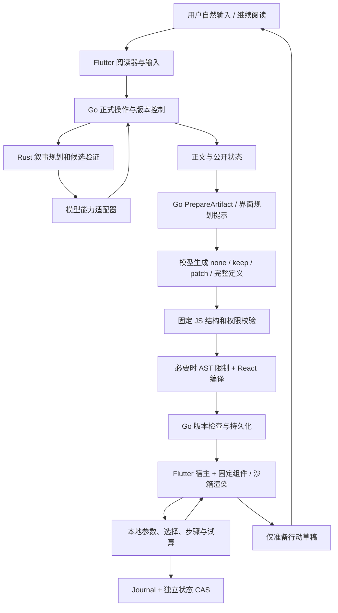

# 将 Generative UI 应用到《人生复本》

日期：2026-10-16。对象：正式产品 `C:\workspace\elselife`，不是旧 JavaScript 演示目录。

## 1. 结论

这份架构文档的核心方向正确：让模型根据任务选择表达和操作方式，而不是每次对话附上一张表。适合本产品的是 **混合式 Generative UI：受约束的声明式组件 + 必要时的沙箱代码 + 独立局部状态 + 受控正式行动**。

我们已经具备这条链路的大部分基础。当前问题不是缺少 React，也不是必须换成 Next.js；而是界面决策、当前任务识别、旧界面归属和跨修订状态保留没有充分闭环。本次以这些直接影响体验的缺口作为第一批落地范围，不为“技术栈看起来相同”重写正式产品。

对齐目标应当是：

- 由当下内容决定表达，不按“简单对话”等题材直接套规则；文字更合适时只用正文，不机械附表、卡片或行动菜单。
- 需要理解关系或构造时，得到适合的图解，而非把所有关系改写为表格。
- 需要探索参数时，能改数值并即时看到结果，不是截图或装饰按钮。
- 自然语言追问可以修改当前工具；仍适用的用户输入不会因为重新生成而消失。
- 界面只能准备或解释行动，不能绕过正式故事的验证与提交。

这些是体验和工程边界，不是“已经全面达到 ChatGPT 智能界面质量”的声明。

## 2. 如何理解用户提供的架构文档

### 2.1 可以直接采纳的机制

文档提出的意图理解、界面规划、声明式描述、渲染器、本地状态和受控工具，是合理的系统分层。特别重要的是：界面不是答案的另一种皮肤，而是帮助用户理解、探索或完成当前任务的工作区。

但“生成结构化界面”不是唯一实现：固定组件描述可靠且易校验，独特的机制演示又可能需要受限代码。本产品同时保留两者，以固定组件优先、沙箱代码补充，而不是让每次回答都走任意代码执行。

### 2.2 不能当作已证实内部架构的内容

React 风格组件、useState、Next.js、Zustand、LangGraph 等属于类比或自建建议。不能因为它们出现在文档里，就断言 OpenAI 内部使用这些具体实现，也不能据此认为装上这些库便获得相同产品能力。

官方说明可以确认的是：回答形式按问题选择，包括必要时只用文字；智能界面包含组件库和生成过程中处理界面的编译器，并关注设计判断与可用性。官方没有在该页面公布一套可直接照搬的内部源码栈。[OpenAI：让每个人都能使用 GPT-6 和智能界面](https://openai.com/zh-Hans-CN/index/gpt-6-for-everyone/)

### 2.3 原文仍需补充的生产细节

原文是方向说明，不是可直接上线的完整设计。还必须明确：

- 任务、世界版本、界面版本和局部状态版本之间的关系。
- 旧模型响应到达时，如何避免覆盖新的正文或新的界面。
- 局部计算和正式行动的权限边界，及服务端重验策略。
- 界面失败、正常不展示、模型不可用的不同含义。
- 生成代码如何验证，用户参数如何迁移，何时必须舍弃旧状态。
- “可渲染”之外，如何验收内容正确、可操作、窄屏可用和键盘可达。

本产品的故事分支与版本系统让这些问题比普通聊天工具更重要。

## 3. 现有系统对应关系

### 3.1 实际链路

这里不是两个相互竞争的 Agent：正文和正式世界仍由既有服务负责，界面层只增加表达与受控局部交互。

### 3.2 各层的职责

**Flutter 宿主**：阅读、当前页归属、自由输入、可视区域、失败恢复、局部 journal。宿主不认定生成界面的文字就是正式世界事实。

**Go**：选定分支与当前版本；裁剪公开上下文；调用模型；校验与编译；artifact head/state CAS；历史快照；正式动作的再次检查与唯一提交。

**Rust**：继续负责叙事候选与原有验证，不直接访问业务数据库，不需要为了 UI 新增世界写入路径。

**固定 JS 运行时**：解释声明式组件和表达式，提供 SVG/关系图/时间线等视图，承载受限 interactive 或编译后的 React。它不是通用网页执行器。

**数据库**：保存故事历史、界面版本和局部状态版本，使恢复、回退、分支隔离与请求幂等有可验证依据。

## 4. 三个核心设计问题的产品解法

### 4.1 UI Planning：先决定有没有必要，再选择形式

过去“主动生成，不要设定过高门槛”的倾向，容易让模型将任何多人、物品、数字整理为面板。另一方面，旧界面没有正确退出当前页，也会造成“每轮都给表格”的感受。不能只改提示词掩盖展示错误，也不能一刀切禁止自动生成。

本次使用当前公开回合 `currentTurn={revision,mode,input,prose}`，并明确触发源 `preparation.trigger`：

- `automatic`：正文完成后按本轮内容设计表达，不等于强制产出，也不降低视觉表达的优先级。
- `requested`：用户主动提出的界面用途。
- `input`：解释尚未执行的自然输入，不能把意图当成已完成行动。

`recentInputs` 仍可帮助理解指代，但历史的“做个表”不自动延续为每个新回合的要求。begin 输入是世界 seed，不能作为公开玩家输入传出；没有匹配当前版本的页时 currentTurn 为 null，不拿旧页冒充。

模型在一次生成中完成用途判断和表达选择，不另外增加一次规划模型调用。允许 `none / keep / patch / 完整定义`：

- 先理解当前剧情里什么值得理解、感受或操作，不以玩家是否要求某种界面为门槛。
- 再判断阅读、观察、对照或动手探索的具体收益；没有收益或会打断当前阅读时选择纯文字。
- 在实际支持的组件、HTML/CSS/SVG/React 中选择最小有效组合，不建立题材到组件的固定映射。
- 表格不禁用：有意义的同维度比较可以用；静态表达合适时不强加交互，需要交互时不用假按钮或截图代替。
- 文字已经提及同一信息，不等于视觉表达没有价值；ASCII 和代码围栏不算已渲染的图示。

这些是内容判断原则，不是关键词开关或模板轮换。UI 是回答的组成部分，不是每次回答之外的必选附件。生成层仍只能解释公开材料，不能创造额外世界事实或自行执行行动。

### 4.2 UI DSL：可靠组件为主，受控代码补足表达力

沿用 schema v1 的 fields、steps、view、actions 与受限表达式；模型不能自由发明表达式根、组件或导入库。已有丰富视图包括 table、chart、diagram、cards、timeline、illustration。

当固定组件无法表达某个交互机制时，可使用一份 interactive 或 React 节点。React 只能使用已登记的组件与允许的 HTML/SVG；提示中明确实际可用的 `@story/ui` 注册项和状态桥，避免生成看似合理但不存在的组件依赖。

校验、编译和沙箱是互补关系：结构有效不证明业务内容真实；代码能编译不证明控件有效；沙箱限制也不替代正式操作授权。当前结构/动作证据校验继续保留，不放宽规则来提高“生成成功率”。

协议兼容继续使用既有字段，本次不新增会破坏存档重验证的 payload 字段。组件注册信息尚分散在提示词、校验器和 renderer，后续需要统一能力清单与兼容测试。

### 4.3 State & Agent Coordination：三种操作不能混在一起

**本地交互**：改人数、选部件、切标签、推进演示步骤。固定规则即时求值，或在沙箱内重算；无需每次调用模型。需保留的状态经过宿主 journal 与独立 state revision CAS 保存。

**模型修订**：用户说“加一个人数滑块”“换成更直观的图”“解释这一段”。将当前已验证定义与局部状态提供给模型，生成 patch 或完整修订，验证后替换界面。该动作本身不推进故事世界。

**正式行动**：买东西、移动、向人物发问、执行确定规则或尝试。界面最多准备草稿或提交受控意图；Go 再检查当前分支、世界 revision、artifact head、定义摘要、依据和权限，事务内签发正式操作。

必须区分四个版本：故事 revision、界面 revision、界面 state revision、客户端未同步 journal。不能用一个全局状态对象代替这些边界，也不能把局部试算结果直接写成世界事实。

## 5. 本次应用范围

### 5.1 当轮语境与表达策略

变更位置：`backend/internal/experience/artifacts.go`、`artifact_prompt.txt`。

补充 currentTurn 与触发类型，保留公开历史依据但降低旧请求的决策权重；明确普通对话 none、有价值时主动生成、真实控件与本地响应、数据依据和草稿边界。

### 5.2 当前页不继承过期界面

变更位置：`frontend/lib/experience/reader_artifact_repository.dart`、`reader_tools.dart`、`reader_prepared_workbench.dart`。

最新正文内联界面必须属于当前 revision，过期 head 不再伪装成这轮结果。生成失败仍保留恢复入口；历史快照和手动查看不等于当前有效界面。

正常 none 与错误分开处理：没有 definition 时，本次 `sourceGame` 与实际 renderer 使用的 `state.game` 都必须有可展示内容。`state.game` 是保留的正式游戏状态，不能因为它还有 surfaces，就让模型已经选择不展示的旧表重新出现；仅有提案而没有实际可渲染状态也不能显示空面板。缺少 sourceGame 的旧存档继续走兼容回退。

### 5.3 局部输入随当前工具修订保留

变更位置：`tools/artifact-validator/retained-state.mjs`、`validate.mjs` 与测试。

客户端把交互节点状态保存在 `artifacts[节点摘要]` 下，改 HTML/TSX 会改变摘要。服务端必须迁移正确的节点状态，而不是只在宿主 state 根层合并 initialState。修订时绑定同一 scope，区分 patch、完整替换与显式迁移，不默认把旧工具输入复制给不相关的新工具。

此修复在 prepare 阶段处理，不修改 archive 的 validate 重验证语义，也不授予局部 state 任何世界写权限。不同工具 ID 或 scope 的新定义还会重置表单参数、步骤与展开状态，由新定义默认值初始化；同名字段不代表含义相同。导航状态保留，正常 none 不擦除可恢复的本机状态。

### 5.4 自然追问与提交前保存

变更位置另包括 `frontend/lib/experience/experience_screen.dart`。

当前回合确有正在展示的有效界面时，自由 act 输入交给已有模型分类器理解，不再必须命中“表格”“加一列”等精确语法。“把成本也考虑进去”可以被解释为修订；模型若判断是故事表达，仍进入原行动路径。混合/不明确要求保留草稿，不自动拆成世界行动。

没有当前界面时仍保留精确显式创建入口和正文之后的自动用途判断；显式 read/ask 模式不改变。这是有界扩展，不声称任意自然语言在任意入口都能零歧义路由。已有界面时增加分类调用也有延迟代价。

分类前通过明确 flush 桥等待尚未完成的本机 journal 写入和状态 CAS，避免用户改滑块后 500ms 内追问丢失新值。保存失败不继续生成；草稿和可重放请求保留。保存期间再修改的状态也需继续保存，而不是只抓取第一次快照。

## 6. 没有引入的技术及原因

- **不迁移 Next.js / Tailwind / shadcn**：正式宿主是 Flutter，已有 JS/React 沙箱；迁移会扩大产品重写面，却不能自动改善界面选择。
- **不新增 Zustand**：目前已有局部状态、journal、防抖保存与 CAS；问题是状态定位和迁移，不是缺少 store 库。
- **不新增 LangGraph 或第二个 Agent**：既有服务已经控制模型调用、版本和操作生命周期；另建编排会增加两个权威状态源。
- **不新增 Recharts / React Flow 依赖**：固定 SVG 和节点组件已经覆盖一批用途；新增图形能力应由确切场景、包体积和沙箱兼容需求驱动。
- **不接回账号、支付或通用外部工具系统**：不属于本次产品需求，且不解决阅读交互问题。

这不是拒绝扩展，而是先补正确的职责、状态和验收闭环。

## 7. 与目标体验仍存在的差距

### 7.1 真正的流式界面尚未实现

正式 PrepareArtifact 当前等待完整模型输出，再校验、编译和提交。Codex CLI adapter 的 Stream 也只是完整生成后一次回调；简单把 Generate 改成 Stream 不会得到真正增量 UI。

建议分两步实施：先提供真实任务阶段与取消/恢复，再在 provider 明确支持 delta 的前提下，流式输出已完整解析且已校验的节点。未闭合 JSON、未验证脚本和未提交正式动作不能提前执行。阶段进度不是流式渲染，报告与 UI 命名应明确区分。

### 7.2 运行质量检查不足

现有服务端校验和编译不能保证生成代码在浏览器正确启动。客户端虽有有限自动修复路径，但正式服务端尚缺提交前隔离浏览器探测和清洗后的编译诊断修复闭环。

后续应对可执行界面检查宽/窄视口、首次控件响应、保存恢复和溢出；运行失败最多进行有限次数修复，保留用户输入并允许继续阅读。不能靠无限重试掩盖失败，也不应每个纯数据视图都启动浏览器。

### 7.3 普通展示的事实来源还不够强

正式 action evidence 已有验证，但普通图表数值、关系边和示意文案主要仍依赖模型遵守公开材料。提示约束不是逐项证据验证。

后续可让事实型节点绑定公开来源引用、派生数值绑定已验证输入与表达式；未知明确显示未知；用户可调假设标为试算。不把“图形画得合理”当作世界事实正确。

### 7.4 game-only 提案不是完整的只读展示投影

固定 renderer 的 game 视图读取正式 `state.game`；仅返回 `sourceGame` 新 surfaces，而不提供 definition，并不会自动产生新的只读视图。本次阻止这种无实际内容的空工作区，但没有把提案复制成正式游戏状态。

本次提示引导新生成界面使用 definition 表达；这是当前设计路径，不是协议禁止 game-only。若未来要完整支持独立 game-only 展示提案，需要专门的只读投影及动作清除/隔离测试，不能为了画出提案而覆盖权威 `state.game`。

### 7.5 跨端、可访问性与注册表治理仍需补齐

当前完整交互主要在 Web 宿主；非 Web surface 仍有 fallback，不能宣称所有 Flutter 原生端已等价支持。生成代码允许 aria 属性也不代表全部控件有正确标签或焦点行为。

后续需要：组件能力/版本清单、旧客户端降级、键盘与读屏检查、移动端手势和窄屏验收。能力声明应来自实际端支持，模型不能生成客户端不会渲染的组件。

## 8. 验证方法与记录

验证分层，避免混淆：

1. 固定夹具单元和集成测试：证明上下文、CAS、scope、恢复与展示规则。
2. 真实模型设计测试：证明模型在本次样例里能合理选择 none、图解或交互；不等于普遍质量保证。
3. 正式 renderer 浏览器操作：证明真实生成结果能响应输入；不能仅从 JSON 节点类型推断可用。
4. Flutter / Go 构建及现有入口检查：证明当前发布可运行；不等于生产部署或所有原生端验收。

真实模型场景包括普通对话、含多人细节的闲聊、已完成的旧图表要求、未要求特定界面的多维度比较、关系梳理、事件先后、可调茶会试算、可点击水车机制演示。材料为虚构夹具，使用隔离数据库，不修改用户故事。

更新前已有七个真实模型样例通过，因此不能声称“旧提示每次必定生成表格”。确定性缺陷来自旧/none 展示与状态迁移；提示调整强化任务判断，仍需持续观察误触发和漏触发。

本次已取得的验证证据：

- 正式后端 `go test ./...` 通过。
- 固定模型 Artifact 集成回归：21 个顶层测试通过，覆盖分支、上下文、CAS、归档重验证、快照、意图收据和正式动作边界，33.397 秒。
- Node validator 回归：16/16 通过；包括先复现的新摘要丢值、不同工具参数污染，再验证修复。
- 最终提示下真实模型：8 个场景及额外 1 个自然追问修订通过，总耗时 193.696 秒。自动多维度比较本轮生成 React 筛选工具；关系图、时间线及声明式试算分别生成，不用固定类型轮换伪造多样性。
- 自然追问修订耗时 46.926 秒，保存的 `speed=0`、`paused=false` 及部件选择保留；生成前后故事页数和 revision 均不变。
- 使用正式 renderer 的隔离浏览器验收：人数从 6 改为 10，点心数量从 12 到 20、花费从 36 到 60、余额从 24 到 0；路线工具同时勾选需要搬运行李和大雨条件后，从 4 条变为 1 条符合；水车切换磨盘并调至 2 倍，部件解释和两项相对转速同步更新。以上局部点按没有模型端点调用。
- 修订后的水车界面在加载时恢复 0 流速，仍可继续调速与切换部件；在 390px 宽度检查了部件名称、控件和说明排版。此处是正式 renderer + 真实生成结果的隔离验收，不冒充对用户真实故事的端到端操作。

浏览器验证还发现一轮模型 HTML 的未加引号 SVG 自闭合属性造成图元缺失。已强化生成规则并通过真实模型重生成与自然修订得到可辨识辐条的示意图；这不是确定性服务端 HTML 语义校验，仍说明运行质量探测有必要。

真实生成结果与截图位于 `C:\Users\16039\Documents\ChatGPT\AI小说游戏\test-results\artifact-design\updated`；截图为 `mechanism-browser.jpg`，使用虚构资料，无模型凭据。

最终发布检查：

- Flutter 全量测试 221/221 通过，其中本次相关范围 57 项；正式分析配置下无 error/warning，154 条风格 info 未做无关的全库清理。
- Flutter Web release 与 Go product-dev 构建通过；前端 102 个构建文件逐项校验哈希后发布。
- 独立审查发现并处理了快速追问丢参数、跨工具状态污染、game-only 空面板三个 P2；最终复核无未处理的发布阻断。
- 仅在核对服务身份、故事操作均空闲且没有后台生成子进程后，平滑重启正式 Go 服务。没有停止无关进程或修改用户故事数据。
- 本地入口 `http://127.0.0.1:18080/` 返回 200，后端健康，模型状态 `available=true`，当前配置为 Codex 本机授权的 `gpt-6.1-sol`。这只说明当次可用检查通过，不保证上游永不失败。

本次没有实现上文列出的真正节点流式、完整 game-only 展示投影、全原生端等价运行或服务端浏览器质量探测。

## 9. 下一阶段排序

第一优先：保留这批真实入口回归，持续衡量不必要展示率、漏展示率、交互成功率、参数保留率与生成耗时。先确保“有用、能操作、不破坏故事”，而非追求组件数量。

第二优先：可见任务阶段、明确的失败类型、有限运行修复和可恢复请求；这些直接改善等待与失效体验。

第三优先：真实增量节点、统一组件能力清单、事实来源绑定，以及原生端和可访问性补齐。每项独立验收，不能以静态截图或演示目录能力替代正式产品入口。

最终判断标准：根据当下内容获得恰当表达，不要求用户先说出形式；需要操作时可以继续操作，纯文字更自然时懂得不打扰。

## 10. 内容驱动表达修正与验收补充

用户进一步明确：关键不是识别“水磨长什么样”这样的问法，而是根据当前剧情自主选择回答形式；支持的元素可以组合，也可以完全不用。此次只修正现有两阶段链路的表达策略，不新增关键词路由、模板选择器或模型调用阶段。

### 10.1 真实失败与根因

用户此前水磨问答的持久化结果是正常 `none`，理由把“正文已提供结构说明和示意图”当作无需界面的依据；正文中的示意实际是 ASCII 围栏。自动准备确实执行了，不是缺少界面关键词导致它未运行。原提示同时存在“正文已经完整”“简单问答直接 none”“界面只补充正文”等判断捷径，削弱了内容本身的表达需求。

`artifact_prompt.txt` 取消这些捷径，改为按本轮内容、阅读节奏、理解或操作收益组织表达；`narrative_response.rs` 让叙事交付可独立阅读的文字与公开依据，不用字符画、围栏或伪控件替代图形，也不预先宣称文字已经足够或界面已经生成。协议、世界写入权限和前端输入路由没有改变。

### 10.2 本轮新增验证

- 新增 `TestArtifactContentCodexLive`：隔离数据库中真实 Rust 叙事运行时和真实 Codex 模型生成开场、下一回合，再以空 `Intent` 调用正式 `PrepareArtifact`；不是用固定正文代替叙事。水磨自然输入、无输入的矿道继续阅读、无输入的安静继续阅读三个场景通过，合计 204.607 秒。
- 水磨本轮生成文字与结构示意；同样的 `read` 空输入在矿道场景生成连接示意，在安静喝茶场景选择 `none`。准备前后正式页、资料、玩法与 revision 不变。
- 既有真实展示模型测试新增 ASCII 场景，仍明确标为固定叙事夹具：9 个场景及 1 个自然修订通过，合计 263.636 秒。普通闲聊、多人细节闲聊、旧请求已结束均无界面；比较、关系、先后、试算与机制演示获得各自有用的表达。
- 验收断言补充原生 game 展示判断，避免只检查 `definition` 导致漏检额外界面，或拒绝合法原生地图；更新断言后再次运行 9 个展示场景及 1 个自然修订，全部通过，274.367 秒。节点类型断言只提供粗粒度检测，不能替代内容和渲染验收。
- 使用正式 renderer 的隔离浏览器核对了水磨的水轮、穿墙横轴、磨盘与粮斗；核对矿道的东西分路、上层汇合、正北下坡和坍塌不通，图示明确不按比例、距离耗时未知。390px 视口可打开滚动缩放查看器。
- 新生成试算人数由 6 改为 10 后，数量 12→20、花费 36→60、余额 24→0；自然修订保留流速 0 与部件选择，随后调至 2 并切到磨盘，解释与两项相对转速同步更新。局部操作未调用模型端点。
- Go 全量普通回归、21 个 Artifact 固定模型集成测试及 Rust 全量测试通过；Go、Rust 构建通过。Rust 保留既有 unused/dead-code 警告。首次 Rust 构建发现缓存内嵌了已删除的旧临时源码路径，只清理本包构建缓存后离线重建，没有修改协议或业务数据。

三个真实叙事场景和 ASCII 局部场景在更新前的单次基线也全部通过。因此本轮没有取得这些样例的确定性红→绿证据，不能说旧版必然失败，也不能凭一次新样例通过宣称误判已根治；此前用户的真实 `none` 与截图才是已观察到的失败。此次证明的是策略矛盾被移除，以及上述样例在新策略下运行、呈现和操作正常，尚未量化漏展示率的改善。

### 10.3 发布与边界

核对已知进程、无活跃故事操作和无其他运行时连接后，停止并启动 Go 与 Rust；网页服务未停，未改用户故事。18080/18081/18083 的进程、构建与协议核验通过，网页返回 200，健康检查正常；模型配置检查返回 `available=true`，不等于上游永不失败。

新策略作用于新回合或显式重新准备请求。历史上已保存的 `none` 不会因为刷新页面自动重算；原有正文也不会被改写。

当前实现仍是“正式正文提交 → 自动表达设计 → 校验并渲染”，并非先共同规划文字与 UI、再任意交错或增量输出。没有改前端，本轮没有重新运行 Flutter 全量测试，也没有操作真实用户故事做浏览器 E2E。浏览器证据为真实后端生成结果加正式 renderer 的隔离验收，位于 `test-results/artifact-design/updated/content-watermill-browser.jpg`、`content-spatial-browser.jpg` 和 `content-quiet-browser.jpg`。

## 11. 去除回答之外的固定管理外壳

用户要求直接清掉反复出现的“查看作品版本”等无关界面，不是把它们搬到另一个菜单。这不是模型根据剧情生成的内容，而是两层固定宿主 UI：Flutter 的 `ReaderPreparedWorkbench` 在有历史条目时直接插入版本下拉框，`renderer.js` 又把所有非地图 advanced 内容套进带导入、导出、版本历史、重复标题和内部理由的工作台。

本次直接删除版本下拉框；所有 advanced 内容直接由 `renderAdvanced` 渲染，不再套工作台。内嵌阅读遇到失败时只保留必要重试/恢复，不附带版本刷新、依据入口或创建作品说明。显式准备面板的准备输入、旧记录浏览路径、底层保存与 CAS、请求恢复和历史数据保持不变。内容自身需要的标题、图示、输入、放大与动作控件也保持不变；没有添加固定的替代 UI。

### 11.1 验证与发布

- 新增内嵌/手动打开 × 单/多历史版本四个 widget 回归，并补充失败恢复无管理控件断言。修改前五处预期失败，修改后定向 12/12 通过；内容 surface 与恢复请求仍在。
- 此次浏览器验收改为真实 `renderer.html` iframe 加正式消息桥，而不是直接调用内部 `renderAdvanced`。旧宿主确实复现导入、导出、版本历史与重复标题；更新后这些固定界面消失。此前直调内部渲染器的验收没有覆盖这一外壳，是前一轮验证遗漏。
- 用既有真实生成的虚构样例核对图示切换和放大；试算人数 6→10 后结果为 20/60/0；机制演示速度 0→2、部件水轮→磨盘后输入与解释保持，宿主回传局部状态未丢失。只读和忙碌状态仍禁用试算输入。没有访问用户故事或再次调用模型。
- Flutter 全量测试 225/225 通过，分析无 error/warning，151 条既有风格 info；Web release 构建与 JS 语法检查通过。独立代码审查未发现生命周期、消息桥或只读保护退化。
- 102 个构建文件逐项校验哈希后发布；18080/18081/18083 服务检查通过。仅更新前端，没有重启后端或改写存档。已打开的页面需要刷新以载入新构建。

这轮证据是 Flutter widget 回归和正式 iframe 宿主隔离交互，不是对用户真实故事的端到端验收；未宣称旧记录管理路径全部删除，也不把删除宿主外壳等同于实现文字与 UI 的联合增量生成。隔离验收截图：`C:\Users\16039\Documents\ChatGPT\AI小说游戏\test-results\artifact-design\updated\content-cleanup-browser.jpg`。
