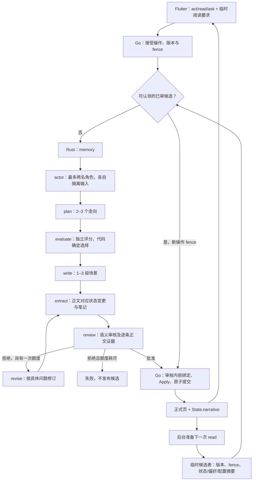

# ElseLife 显式叙事引擎：实现与验收记录

本轮是用户要求的体系化重构，延续当前 Flutter / Go / Rust / PostgreSQL。代码、本地运行入口和增量迁移已完成，现可在 `http://127.0.0.1:18080/` 测试。没有公网部署。首段性能目标尚未达到，文学质量也没有获得全面改善的验收。

## 调用与提交链路

空角色列表直接进入 plan。ask 单独走 answer → review，只接收读者投影，不修改世界与笔记。调用总数含回取最多 12 次，角色最多 2 名，修订最多 1 次。Rust 不访问业务 SQL；Go 仍是唯一提交者。

## 八个方向对应的代码机制

| 方向 | 实现机制 | 仍需阅读检验的部分 |
| --- | --- | --- |
| 记忆连续性 | `State.narrative` 保存事件摘要、角色档案、伏笔计划；来源指向正式事实，随历史与分支保存 | 长篇取舍是否遗漏重要细节 |
| 人物自主性与知情 | memory 选角色；Go 为 actor 重建 known_by 投影；目标、关系、声音独立保存 | 目标是否鲜明，拒绝与成长是否可信 |
| 选择与后果 | plan 显式列因果、代价、后果；evaluate 独立判断；确定性代码选候选 | 后果是否具有叙事分量 |
| 伏笔与节奏 | arcs 保存状态、张力、后续节拍和回收条件，审核回收依据 | 长篇张弛是否自然 |
| 中文表达 | writer 生成短场景；review 提具体问题；至多一次局部修订 | 文学质量不能由 JSON 合法性证明 |
| 阅读偏好 | 保留长期偏好 CAS；增加独立、可恢复且只消费一次的 reading_request | 个性化是否重复、是否损伤人物自主性 |
| 等待体验 | 正式短页；提交后准备下一段；匹配后重新通过正式提交；公开阶段进度 | 首段多调用成本、准备未命中及并发开销 |
| 持续评价 | 固定模型验证协议，真实模型合成故事保留正文、调用与阶段耗时，失败证据同样留存 | 目标读者反馈、多次重复与更长章节评测 |

## 权威与数据边界

- `backend/internal/experience/narrative_pipeline.go`：阶段状态机、角色输入重建、正文提取一致性、审核回执绑定。模型说“通过”不会直接生成正式页。
- `backend/internal/experience/narrative_state.go`：笔记结构及来源、类型、版本验证。笔记上限 12 KiB；它是衍生记忆，不替代正式事实。
- `backend/internal/experience/narrative_preparation.go` 与 `backend/internal/sqlc/queries/experience_narrative.sql`：准备生命周期、租约、失效、认领。准备数据不进入归档。
- `algorithms/src/narrative_pipeline.rs`：有界阶段编排、中间结构、候选评分、正文提取与复审。v4 不回退 prose-first。
- `frontend/lib/experience/experience_controller.dart`：公开阶段、准备状态轮询、正式页恢复和临时反馈生命周期。
- `contracts/experience/v1/contract.json`、`contracts/algorithm/v1/runtime.proto`：共享笔记与阶段协议，各端快照与生成绑定同步。

`known` 表示读者可见，`known_by` 表示人物知道。新增事实与人物获知边必须在审核中逐条引用正文；Go 检查引用、覆盖和最终内容相同，模型负责语义判断。引文存在不构成机器证明，语义审核仍可能错判。

历史归档可以没有 narrative 字段；新 v4 非 ask 候选必须带笔记。ReaderState、ask、公开进度与准备 API 不返回私有笔记、候选或作者附件。

## 明确取舍

角色调用只接收已知事实及自己的档案。目前当前行动只有完整直接称呼的引号对白能作为条件性尝试传入 actor；一般自然语言行动仍由导演、作者与审核阶段处理，不会整体转发给被提到的角色。这避免把秘密行动泄露给场外人物，但不是完整的事件可观察性解释器。

准备命中只适用于同版本、同 fence、同状态、同偏好/作者资料/配置的空输入 read。act、ask、临时要求、偏好修改等使不匹配候选失效。尚在生成的准备会取消；当前实现不复用它的半成品。因此不能根据命中耗时推断所有交互都更快。

没有训练模型、建立向量库或独立常驻 NPC 服务。旧事实仍为追加历史，记忆整理不回写已发布正文。首段在完整审核后才显示。

## 本地体验检查

服务切换并验证后，在 `http://127.0.0.1:18080/` 强制刷新页面，再新建故事。可以使用现有合成样例 `backend/internal/experience/testdata/narrative/continuous-reading.json` 的开局与顺序行动，避免用真实经历测试。

1. 观察生成阶段是否依次变化；阶段提示不应替换成未正式提交的正文。
2. 私下交出账册后，下一段检查保管者是否延续；远处守卫不应无依据知情。
3. 对已经售出的戒指提出身份认证需求，检查后文是否承接失去凭证的处境。
4. 在阅读反馈里输入“减少解释，多用动作和对白”，选择“用于下一段”。成功提交后此条要求应被消费；它不进入长期偏好。
5. 等到下一段准备就绪再继续，与刚提交就立刻继续的等待分开观察。新行动及新阅读要求不能误用旧准备。
6. 使用 ask 询问物品归属，确认它解释已读内容，没有推动故事时间、转移物品或替人物作决定。

这些是人工阅读检查，不是预先承诺每次模型输出必然达到文学目标。开发者可从公开 Operation.progress 与 preparation API 验证阶段、版本；它们不提供隐藏计划。

## 验证记录

固定模型与工程检查：Go 全量 `-race -tags=integration` 为 318 项通过、1 项预期 helper 跳过，`go build ./...` / `go vet ./...` 通过；后续历史回取、完整大笔记容量和合成回放恢复均通过定向 race 检查。最终默认 Rust 80 项、无默认特性 74 项通过；真实 protobuf 通道覆盖完整阶段、一次修订、正式提交、准备命中和 ask 隔离。Python 15 项、共享协议检查通过。最终 Flutter 全量 275 项通过，analyze 无 error/warning、155 条既有 info，release Web 构建通过。

真实模型使用本机 Codex CLI 接入的 `gpt-6.1-sol`、合成故事、隔离数据库；耗时包含每次 CLI 调用成本，不代表其他推理服务的速度。失败样本没有删去：

| 运行 | 结果与暴露的问题 |
| --- | --- |
| `v4-20261019T072916Z` | 首段 184.423 秒提交；下一 act 角色引用范围在 Go/Rust 两端不一致而失败。已统一当前已加载且 known_by 允许的事实，添加精确回归。 |
| `v4-20261019T074225Z` | 共同对比场景连续 4 页提交，等待分别 159.651、173.099、172.353、168.148 秒。准备第 5 页时模型生成 4 项 next_beats，超过合同上限 3，严格提取拒绝；没有正式发布失败候选。随后补充合同派生的嵌套限额指南。 |
| `replay-20261019T080402Z` | 修订后从完全相同的前四页 mode/input/text/state 恢复到临时 PG。下一页准备 181.168 秒，成为 ready 后正式 read 等待 100 毫秒、零模型调用；ask 等待 33.095 秒、两次调用，正式状态不变。测试通过。缺失的旧 title/suggestions/outcome 仅作为历史展示元数据重建。 |

第二次运行还暴露了叙事过于停滞、初始实体描述与后续物品转移混淆。随后只修订创作边界提示及实体资料呈现；修订前正文保留供对比。新增事件仍须符合既有事实、玩家授权和角色信息边界，不能把纠正停滞变成强制推进或迎合玩家。

回放中增加了可继续调查的断绳，明确尚不能断定与失货有关，ask 保留物品归属及守卫知情的不确定性。独立阅读复核仍指出同伴行动不足、相同收尾反复出现及观察视角略含混。完整正文和失败候选见 [真实阅读样本](2026-10-19-narrative-engine-samples.md)。

最终回放与当前本地 Rust 二进制 SHA256 均为 `0577e96b71b8aa1bbedcd0e656af64611b51f16b66d501b39def5e5de8488989`。早期样本不能归因于最后的提示修订。资料标签与 10 分钟准备状态轮询是在连续样本运行期间修订的，不改写已有正文或世界状态。

前四页平均等待 168.313 秒。之前 v3 同场景单次样本的平均约 21.1 秒；阶段、正文和运行次数不同，不能作统计性比较，但足以说明本轮冷生成明显更慢，尚未达到首段加速目标。准备耗时和命中等待必须分别统计，不把后台用时隐藏为“零成本”。

原始报告在忽略版本控制的 `.validation/narrative-evaluation/` 中；正文都是人工设定的合成情节。当前结构设计、固定模型测试及真实阅读样本必须分别解读，不能互相替代。

本地切换前已确认无 pending/generating 故事操作、无目标服务子任务；仅对核验身份的旧 Go/Rust 进程发送 SIGTERM，原数据库和 Web 服务保留。启动时应用增量迁移，随后核对三个端口、运行二进制与新合同 hash；Windows 侧首页返回 HTTP 200，API meta 为新合同 `61441550…`。当前代码未提交或推送；并发出现的作者世界与门户改动保留，但不归为本轮叙事重构。
